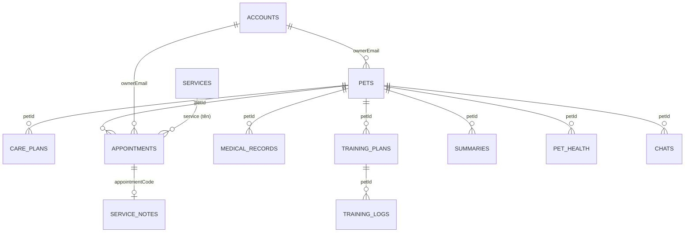

# Mô hình dữ liệu

## 1. Tổng quan

Dữ liệu nằm trong một mock REST API duy nhất, phục vụ cả 4 cổng và luồng xác thực.

| Tệp | Vai trò |
|---|---|
| `mock-api/seed.json` | Dữ liệu gốc, không bị ghi đè |
| `mock-api/db.json` | Dữ liệu đang chạy; mọi POST/PUT/PATCH/DELETE ghi vào đây |
| `mock-api/server.js` | REST API + static server cho Node.js |
| `mock-api/server.py` | Bản tương đương cho Python 3 |
| `core/api.js` | Client `window.MockAPI` |
| `mock-api/api.js` | Facade `PC.api`, session, guard, tiện ích UI cho cổng HLV |

Server chép `seed.json` → `db.json` khi `db.json` chưa tồn tại. `POST /api/reset` khôi phục dữ liệu gốc.

## 2. Số lượng bản ghi (seed và db hiện tại)

| Resource | Số bản ghi | Vai trò sử dụng |
|---|---:|---|
| `accounts` | 23 | Đăng nhập, đăng ký, RBAC |
| `pets` | 15 | Chủ nuôi, đối tác, HLV, quản trị |
| `care-plans` | 15 | Chủ nuôi, đối tác |
| `appointments` | 20 | Chủ nuôi, đối tác, quản trị |
| `calendar-events` | 18 | Đối tác |
| `service-notes` | 1 | Đối tác |
| `medical-records` | 15 | Chủ nuôi, đối tác, HLV |
| `services` | 15 | Quản trị |
| `exercises` | 15 | HLV |
| `trainingPlans` | 15 | HLV |
| `trainingLogs` | 25 | HLV |
| `summaries` | 0 | HLV tạo, chủ nuôi đọc |
| `petHealth` | 0 | HLV tạo/đọc |
| `chats` | 0 | HLV tạo/đọc |

`summaries`, `petHealth`, `chats` bắt đầu rỗng và được tạo trong quá trình demo. Đây là các resource chứng minh luồng tạo mới + đọc lại sau F5.

## 3. Lược đồ chính

### 3.1 `accounts`

| Trường | Kiểu | Ghi chú |
|---|---|---|
| `id`, `uid` | string | Khóa chính |
| `name`, `email`, `phone` | string | Email dùng để đăng nhập |
| `password` | string | Demo, lưu plaintext – chỉ dùng cho nguyên mẫu |
| `role` | enum | `owner`, `provider`, `trainer`, `admin` |
| `dirRole` | enum | `chu-nuoi`, `bac-si`, `hlv`, `spa` (dùng cho bộ lọc RBAC) |
| `status` | enum | `active`, `pending`, `locked` |
| `roleLabel`, `chip`, `roleIcon` | string | Metadata hiển thị |
| `joined`, `lastActive`, `avatar` | string | Hiển thị |

Tài khoản demo: `owner@demo.com`, `provider@demo.com`, `trainer@demo.com`, `admin@demo.com`, `locked@demo.com`; mật khẩu `demo123`.

### 3.2 `pets`

| Trường | Kiểu | Ghi chú |
|---|---|---|
| `id` | string | Khóa chính |
| `ownerEmail` | string | Liên kết `accounts.email` |
| `name`, `species`, `breed`, `sex`, `age`, `birth` | string | Hồ sơ cơ bản |
| `weight`, `chip`, `code` | string | Cân nặng, mã chip, mã hồ sơ |
| `status` | enum | `healthy`, `needs-care` |
| `vaccine`, `note` | string | Tiêm phòng, ghi chú |
| `avatar`, `cover` | URL | Ảnh thú cưng |

Milo: `id = 1`, `ownerEmail = owner@demo.com`, Golden Retriever, 3 tuổi, 28 kg, `#VN-88219`, trạng thái `healthy`.

### 3.3 `care-plans`

| Trường | Kiểu | Ghi chú |
|---|---|---|
| `id`, `code` | string | `code` dạng `#PC-YYYYMMDD-HHMM` |
| `petId`, `petName` | string | Liên kết `pets` |
| `service`, `type`, `typeLabel`, `icon` | string | Loại lịch |
| `date`, `time`, `duration` | string | Ngày giờ |
| `location`, `provider` | string | Địa điểm/nhà cung cấp |
| `status` | enum | `confirmed`, `pending`, `cancelled` |
| `statusLabel`, `note` | string | Hiển thị |

### 3.4 `appointments`

| Trường | Kiểu | Ghi chú |
|---|---|---|
| `id`, `code` | string | `#APT-xxxx` |
| `petId`, `pet`, `owner`, `ownerEmail`, `phone` | string | Liên kết pet/chủ nuôi |
| `service`, `serviceChip` | string | Dịch vụ |
| `time`, `timeSub`, `timeSubColor` | string | Hiển thị thời gian |
| `room`, `partner`, `img` | string | Phòng, đối tác, ảnh |
| `status` | enum | `pending`, `processing`, `urgent`, `approved`, `completed`, `cancelled` |
| `statusText`, `action` | string | Nhãn và hành động gợi ý |

### 3.5 `calendar-events`

`id`, `date`, `time`, `code`, `pet`, `owner`, `service`, `room`, `type`. Dùng để vẽ lịch tháng/tuần của đối tác.

### 3.6 `service-notes`

`id`, `appointmentCode`, `patientName`, `clinicalExam`, `prescription`, `ownerNote`, `checklist[]`, `costs[]`, `status`, `signedAt`.

- `checklist[]`: `{ id, text, checked }`.
- `costs[]`: `{ name, amount }`.
- Hiện chỉ có 1 bản ghi cho Milo (`#APT-1048`).

### 3.7 `medical-records`

`id`, `code`, `petId`, `petName`, `type`, `typeLabel`, `service`, `serviceSub`, `provider`, `doctor`, `date`, `time`, `cost`, `status`, `statusLabel`, `summary`, `diagnosis`, `prescriptions`, `advice`, `files`, `recheck`.

Đây là nguồn cho trang Lịch sử dịch vụ & Bệnh án của chủ nuôi.

### 3.8 `services`

`id`, `name`, `sku`, `desc`, `cat`, `categoryLabel`, `chip`, `sq`, `icon`, `duration`, `price`, `partners`, `partnerIcon`, `active`, `hidden`.

- `cat`: `y-te`, `spa`, `hl`.
- `active`: đang cung ứng / tạm dừng.
- `hidden`: ẩn khỏi danh sách.

### 3.9 `exercises`

`id`, `category`, `difficulty`, `duration`, `learners`, `title`, `desc`, `props`, `propKeys`, `steps[]`, `mistakes[]`, `criteria[]`, `img`, `archived`, `updatedAt`.

### 3.10 `trainingPlans`

`id`, `petId`, `title`, `level`, `status`, `weeks`, `perWeek`, `week`, `goals[]`, `tags[]`, `note`, `homework`, `exerciseIds[]`, `archived`, `certified`, `certifiedAt`.

- `goals[]`: `{ text, state }` với `state` là `todo`, `doing`, `done`.
- `status`: `new`, `in_progress`, `attention`, `paused`, `graduated`.

### 3.11 `trainingLogs`

`id`, `petId`, `session`, `date`, `goal`, `result`, `note`, `trainer`, `area`, `score`.

- `result`: `pass`, `practice`, `excellent`.
- `score`: 0–100.

### 3.12 `summaries` (AI-3)

Do `Trainer/progress.js` tạo:

| Trường | Kiểu | Ghi chú |
|---|---|---|
| `id` | string | Khóa chính |
| `petId` | string | Liên kết pet |
| `sessionIds` | string[] | Các buổi được phân tích |
| `html` | string | Tóm tắt tiến độ |
| `planHtml` | string | Đề xuất điều chỉnh giáo án |
| `reasonHtml` | string | Căn cứ suy luận |
| `status` | enum | `new`, `draft`, `sent` |
| `updatedAt`, `sentAt` | ISO string | Thời điểm |

Chủ nuôi chỉ đọc các bản ghi có `status = sent` và `petId` thuộc quyền sở hữu.

### 3.13 `petHealth` (HLV)

`petId`, `weight`, `dewormDate`, `vaccineStatus`, `vaccines`, `nutrition`, `clinic`. Lưu từ modal “Sổ theo dõi thú y”.

### 3.14 `chats` (HLV)

`petId`, `messages[]` với `{ from, text, at }`. Mỗi pet một cuộc trò chuyện.

## 4. Quan hệ dữ liệu



Lưu ý: liên kết chủ yếu bằng **email** hoặc **id dạng chuỗi**, không có khóa ngoại thật. Vì vậy khi đổi `petId`/`ownerEmail` phải cập nhật thủ công các bản ghi liên quan.

## 5. API

Base: `/api/v1`.

| Thao tác | Endpoint | Ghi chú |
|---|---|---|
| Danh sách | `GET /api/v1/<resource>` | Hỗ trợ `search`, lọc trường, `sortBy`, `order`, `page`, `limit` |
| Chi tiết | `GET /api/v1/<resource>/<id>` | Trả 404 nếu không có |
| Tạo | `POST /api/v1/<resource>` | Sinh id nếu thiếu |
| Thay thế | `PUT /api/v1/<resource>/<id>` | Ghi đè toàn bộ |
| Cập nhật | `PATCH /api/v1/<resource>/<id>` | Giữ trường không gửi |
| Xóa | `DELETE /api/v1/<resource>/<id>` | Xóa cứng |
| Sức khỏe | `GET /api/health` | Số bản ghi từng resource |
| Khôi phục | `POST /api/reset` | Chép lại từ seed |

Ví dụ:

```js
await MockAPI.list('appointments', { status: 'pending' });
await MockAPI.patch('care-plans', 12, { status: 'cancelled' });
await MockAPI.create('summaries', { petId: '1', status: 'sent' });
```

## 6. Cách kích hoạt trạng thái dữ liệu khi demo

| Trạng thái | Cách làm | Phạm vi |
|---|---|---|
| Loading | Thêm độ trễ mạng trong DevTools Network, hoặc mở trang lần đầu | Tất cả |
| Empty | `?empty=1` | Chỉ các trang HLV dùng `PC.api` |
| Error | `?fail=1` | Chỉ các trang HLV dùng `PC.api` |
| Error toàn hệ thống | Tắt mock server rồi tải lại trang | Tất cả |
| Empty theo bộ lọc | Nhập từ khóa không tồn tại | Tất cả danh sách |
| Dữ liệu mới | Tạo pet/lịch/báo cáo rồi F5 | Tất cả |
| Reset | `await PC.api.reset()` hoặc `POST /api/reset` | Tất cả |

Lưu ý: cổng chủ nuôi/đối tác/quản trị gọi `MockAPI` trực tiếp, nên `?fail=1` và `?empty=1` **không** tác động các cổng này. Khi demo trạng thái lỗi ở các cổng đó, phải tắt server hoặc chặn request trong DevTools.

## 7. Quy tắc nhất quán dữ liệu

1. `pets.ownerEmail` phải khớp `accounts.email` của chủ nuôi.
2. `care-plans.petId`, `appointments.petId`, `medical-records.petId`, `trainingPlans.petId`, `trainingLogs.petId`, `summaries.petId` phải trỏ tới `pets.id`.
3. `service-notes.appointmentCode` phải khớp `appointments.code`.
4. `summaries.status = sent` mới được hiển thị cho chủ nuôi.
5. `trainingPlans.exerciseIds` phải trỏ tới `exercises.id`.
6. `accounts.password` chỉ là dữ liệu demo; không dùng mật khẩu thật.
7. Mọi thay đổi ghi vào `db.json`; `POST /api/reset` khôi phục dữ liệu seed.

## 8. Vấn đề dữ liệu đã biết

| Vấn đề | Ảnh hưởng | Hướng xử lý |
|---|---|---|
| Milo seed 28 kg, brief ghi 24,3 kg | Lệch tài liệu – giao diện | Chọn 28 kg làm chuẩn, đã ghi trong `docs/README.md` |
| `accounts` có `admin` nhưng RBAC không map | Admin hiển thị “Chủ nuôi” | Thêm `admin` vào `AUTH_TO_DIR`, thêm lựa chọn lọc Admin |
| `service-notes` chỉ 1 bản ghi | Khó demo danh sách | Tạo thêm bản ghi hoặc demo trên Milo |
| `summaries` rỗng ban đầu | Chủ nuôi chưa thấy báo cáo | Demo AI-3 gửi báo cáo trước khi mở trang chủ nuôi |
| `password` plaintext | Không an toàn ngoài phạm vi demo | Ghi rõ trong README, không dùng dữ liệu thật |
| Render có thể reset ổ đĩa khi redeploy | Mất dữ liệu đã tạo | Seed lại hoặc chấp nhận reset khi demo |
