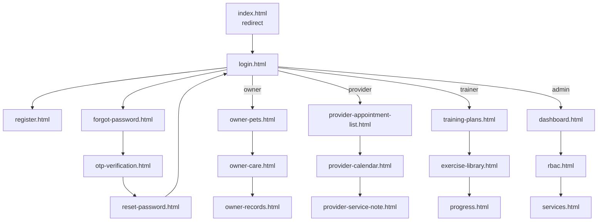

# Project Proposal – PetCompanion (BTL-35)

## 1. Thông tin đề tài

| Hạng mục | Nội dung |
|---|---|
| Tên sản phẩm | PetCompanion – Hồ sơ chăm sóc và lịch dịch vụ thú cưng |
| Mã đề tài | BTL-35 |
| Lĩnh vực | Chăm sóc thú cưng / PetTech |
| Học phần | CSE122 – Phát triển ứng dụng Web cơ bản |
| Nhóm | 3 sinh viên |
| Loại sản phẩm | Web frontend nguyên mẫu, nhiều vai trò, CRUD, responsive, JavaScript/DOM, trải nghiệm AI mô phỏng |
| Repository | https://github.com/vutruonganh/Pet_Companion |
| Live demo | https://pet-companion-1.onrender.com |
| Figma | https://www.figma.com/design/kDpGBVivQSuSpebbNhzGrr/bai-tap?t=h8VNXReX6DUHmzMW-0 |
| Notion | https://app.notion.com/p/3f3f0a1d9f4980858c77d1a28bf40b70?v=3f3f0a1d9f498013bd4f000c8f350ef8&source=copy_link |
| Tài liệu liên quan | [`screen-inventory.md`](screen-inventory.md), [`roles-and-features.md`](roles-and-features.md), [`ai-features.md`](ai-features.md), [`data-model.md`](data-model.md) |

## 2. Ngữ cảnh

Lịch chăm sóc, grooming, huấn luyện và ghi chú sức khỏe của thú cưng thường nằm rải rác ở nhiều nơi: sổ giấy, tin nhắn với bác sĩ, lịch điện thoại, ghi chú của huấn luyện viên. Chủ nuôi khó trả lời nhanh ba câu hỏi cơ bản:

1. Thú cưng của tôi sắp có lịch gì?
2. Hồ sơ sức khỏe và dị ứng của bé nằm ở đâu?
3. Lần trước bé đã dùng dịch vụ gì, kết quả ra sao?

PetCompanion gom các dữ liệu đó vào một sản phẩm web nhiều vai trò. Sản phẩm **không chẩn đoán thú y**; phần AI chỉ hỗ trợ tóm tắt, nhắc lịch và soạn checklist dựa trên dữ liệu sẵn có.

## 3. Phát biểu vấn đề

| Mã | Vấn đề | Biểu hiện trong sản phẩm |
|---|---|---|
| P1 | Lịch chăm sóc dễ quên | Lịch tiêm, tẩy giun, grooming nằm rải rác; thiếu nhắc trước hạn |
| P2 | Hồ sơ thú cưng phân tán | Cân nặng, dị ứng, hành vi, ghi chú nằm ở nhiều công cụ khác nhau |
| P3 | Nhà cung cấp thiếu ghi chú trước buổi | Không biết thú cưng dị ứng gì, sợ tiếng ồn hay cần lưu ý gì |
| P4 | Chủ nuôi khó xem lại lịch sử dịch vụ | Không có nơi tra cứu lần khám, toa thuốc, kết quả gần đây |

## 4. Mục tiêu

| Mã | Mục tiêu | Cách thể hiện |
|---|---|---|
| O1 | Hành trình người dùng rõ ràng | Đăng nhập theo vai trò → nghiệp vụ chính → trạng thái/phản hồi → AI hỗ trợ → chấp nhận/sửa/từ chối → vai trò khác xử lý → dashboard |
| O2 | Mỗi vai trò có ít nhất 3 màn hình | Chủ nuôi 3, đối tác 3, HLV 3, quản trị 3; cộng 6 màn hình dùng chung |
| O3 | CRUD/trạng thái nghiệp vụ thật | Tạo/sửa/ẩn dịch vụ, khóa/mở tài khoản, nhận ca, hoàn tất, hủy lịch, gửi báo cáo |
| O4 | JavaScript/DOM cho tìm kiếm, lọc, validation, modal, trạng thái | Tìm kiếm + lọc + phân trang ở HLV; filter ở đối tác/quản trị; validate ở đăng nhập/đăng ký/đặt lịch |
| O5 | Dữ liệu giả lập qua API | Mock REST API 14 resource, seed 15–25 bản ghi/resource, reset được |
| O6 | Ít nhất 3 trải nghiệm AI | AI-1 Care Reminder, AI-2 Service Checklist, AI-3 Training Progress Summary |
| O7 | Quản lý nhóm bằng Git/GitHub | 3 tác giả commit, 4 nhánh feature/branch + PR #1; bảng công việc trên Notion |

## 5. Vai trò và quyền hạn

| Vai trò | Mã vai trò | Trách nhiệm chính | Tài khoản demo |
|---|---|---|---|
| Chủ nuôi | `owner` | Quản lý hồ sơ pet, lịch chăm sóc, lịch sử dịch vụ, nhận báo cáo HLV | `owner@demo.com` |
| Đối tác dịch vụ | `provider` | Lịch làm việc, danh sách ca hẹn, biên bản dịch vụ/checklist | `provider@demo.com` |
| Huấn luyện viên | `trainer` | Kế hoạch huấn luyện, thư viện bài tập, tiến độ và báo cáo cho chủ nuôi | `trainer@demo.com` |
| Quản trị viên | `admin` | Dashboard, người dùng/RBAC, dịch vụ | `admin@demo.com` |
| Tài khoản bị khóa | `owner` + `locked` | Kiểm thử trạng thái từ chối đăng nhập | `locked@demo.com` |

Mật khẩu chung của tài khoản demo: `demo123`.

## 6. Sitemap



## 7. Luồng người dùng chính

### 7.1 Đăng nhập và điều hướng theo vai trò

```text
login.html
→ chọn vai trò hoặc nhập email/mật khẩu
→ PC.api.list('accounts') kiểm tra tài khoản
→ nếu status = locked: từ chối
→ lưu session (sessionStorage hoặc localStorage nếu "Ghi nhớ")
→ điều hướng theo PC.session.home(role)
```

- Chủ nuôi → `owner/owner-pets.html`
- Đối tác → `provider/provider-appointment-list.html`
- HLV → `Trainer/training-plans.html`
- Quản trị → `admin/dashboard.html`

### 7.2 Chủ nuôi: từ hồ sơ đến lịch chăm sóc và lịch sử

```text
owner-pets.html
→ xem danh sách pet, tìm kiếm/lọc, thêm pet mới
→ mở lịch chăm sóc
→ nhận đề xuất AI-1 (tẩy giun/vắc-xin)
→ Chấp nhận / Điều chỉnh / Bỏ qua
→ chấp nhận tạo care-plan mới
→ xem lịch tháng, hủy lịch nếu cần
→ xem lịch sử dịch vụ/bệnh án ở owner-records.html
```

### 7.3 Chủ nuôi: đặt dịch vụ

Luồng đặt dịch vụ được gộp trong `owner-care.html` bằng modal “Tạo lịch nhắc / Đặt hẹn”, không tách thành trang riêng:

```text
Chọn pet → chọn loại dịch vụ → chọn ngày/giờ
→ chọn địa điểm/nhà cung cấp → ghi chú
→ lưu care-plan
→ đồng thời tạo appointment để cổng đối tác nhìn thấy
```

### 7.4 Đối tác: nhận ca, cập nhật trạng thái, ghi biên bản

```text
provider-appointment-list.html
→ tìm kiếm/lọc ca hẹn
→ nhận ca (pending → processing)
→ hoàn tất ca (processing → completed)
→ mở biên bản dịch vụ
→ checklist AI-2 + ghi chú lâm sàng + toa thuốc
→ lưu nháp hoặc ký số
→ tạo medical-record cho chủ nuôi
```

### 7.5 HLV: ghi nhật ký, phân tích AI-3, gửi báo cáo

```text
training-plans.html
→ chọn giáo án, xem tiến độ, thêm nhật ký buổi tập
→ progress.html
→ chọn các buổi cần phân tích
→ AI-3 tính điểm trung bình, tỷ lệ đạt, xu hướng, điểm mạnh/yếu
→ xem tóm tắt + đề xuất + lý do
→ Sửa / Tạo lại / Lưu nháp / Chấp nhận & Gửi báo cáo
→ summaries.status = sent
→ owner-pets.html hiển thị thẻ "Báo cáo từ HLV"
```

### 7.6 Quản trị: duyệt ca, quản lý người dùng, dịch vụ

```text
dashboard.html
→ xem KPI, biểu đồ, ca chờ duyệt
→ duyệt/từ chối ca
→ rbac.html: tìm kiếm, lọc vai trò/trạng thái, thêm/khóa/mở/khóa tài khoản
→ services.html: thêm/sửa/ẩn dịch vụ, bật/tắt cung ứng, cấu hình AI Checklist
```

## 8. Ma trận thực thể và quyền thao tác

Ký hiệu: **C** tạo, **R** đọc, **U** cập nhật, **D** xóa/ẩn, **A** duyệt/trạng thái.

| Thực thể | Chủ nuôi | Đối tác | HLV | Quản trị |
|---|---|---|---|---|
| `accounts` | R (đăng nhập) | R (đăng nhập) | R (đăng nhập) | C R U D (khóa/mở) |
| `pets` | C R U | R | R (rút gọn) | R |
| `care-plans` | C R U (hủy) | R | – | R |
| `appointments` | C R U (hủy) | C R U A | – | R U A |
| `calendar-events` | R | C R U D | – | R |
| `service-notes` | – | C R U | – | – |
| `medical-records` | R | C R | R | R |
| `services` | – | R | – | C R U D |
| `exercises` | – | – | C R U D | – |
| `trainingPlans` | – | – | C R U | – |
| `trainingLogs` | – | – | C R | – |
| `summaries` | R (đã gửi) | – | C R U | – |
| `petHealth` | – | – | C R U | – |
| `chats` | – | – | C R U | – |

## 9. Ma trận trạng thái nghiệp vụ

| Thực thể | Trạng thái | Ý nghĩa | Nơi hiển thị |
|---|---|---|---|
| `appointments` | `pending` | Chờ tiếp nhận | Đối tác, quản trị |
| | `processing` | Đang khám/đang phục vụ | Đối tác |
| | `urgent` | Cấp cứu, ưu tiên | Đối tác, quản trị |
| | `approved` | Đã duyệt | Quản trị |
| | `completed` | Hoàn tất | Đối tác, quản trị |
| | `cancelled` | Đã hủy | Đối tác, quản trị |
| `care-plans` | `confirmed` | Đã xác nhận | Chủ nuôi |
| | `pending` | Chờ xác nhận / AI đề xuất | Chủ nuôi |
| | `cancelled` | Đã hủy | Chủ nuôi |
| `trainingPlans` | `new` | Giáo án mới | HLV |
| | `in_progress` | Đang thực hiện | HLV |
| | `attention` | Cần chú ý | HLV |
| | `paused` | Tạm hoãn | HLV |
| | `graduated` | Tốt nghiệp | HLV |
| `summaries` | `draft` | Bản nháp AI-3 | HLV |
| | `sent` | Đã gửi chủ nuôi | HLV + chủ nuôi |
| `accounts` | `active` | Hoạt động | Đăng nhập, quản trị |
| | `pending` | Chờ duyệt | Quản trị |
| | `locked` | Bị khóa | Đăng nhập, quản trị |
| `services` | `active` | Đang cung ứng | Quản trị |
| | tạm dừng (`active = false`) | Ngừng nhận | Quản trị |
| | ẩn (`hidden = true`) | Ẩn khỏi danh sách | Quản trị |

## 10. Phạm vi

### Trong phạm vi

- 18 màn hình HTML/CSS/JavaScript thuần, không build step.
- 4 cổng vai trò + 6 màn hình xác thực dùng chung.
- Mock REST API Node.js/Python, dữ liệu seed và reset.
- CRUD thực trên dịch vụ, tài khoản, giáo án, bài tập, lịch chăm sóc, ca hẹn.
- Tìm kiếm, lọc, sắp xếp/phân trang ở các màn hình có danh sách.
- 3 trải nghiệm AI mô phỏng, có bước giải thích lý do và chấp nhận/sửa/từ chối.
- Responsive ở 320/375/768/1280 px.
- Deploy Render, chạy local bằng Node hoặc Python.

### Ngoài phạm vi

- Chẩn đoán y khoa, kê đơn tự động, tư vấn thú y chuyên môn.
- Backend thật, xác thực bảo mật, thanh toán, email/SMS thật.
- Gọi LLM thật; AI trong bản này là mô phỏng xác định (rule-based/dữ liệu soạn sẵn).
- Ứng dụng mobile native.
- Phân quyền server-side; guard hiện là guard phía client.

## 11. Tiêu chí nghiệm thu

Sản phẩm được coi là đạt khi:

1. Đăng nhập được bằng 4 tài khoản demo và đi đúng cổng vai trò.
2. Mỗi vai trò hoàn thành được luồng chính từ đầu đến cuối mà không sửa URL thủ công.
3. Dữ liệu tạo mới còn nguyên sau F5 (ghi vào `db.json`).
4. Có thể kích hoạt Loading / Empty / Error khi demo.
5. AI-3 gửi báo cáo và chủ nuôi nhìn thấy báo cáo trên trang hồ sơ.
6. Không có lỗi console ở luồng chính.
7. README chạy local trong 5 phút trên máy sạch.
8. Mỗi màn hình có video OBS và commit/PR tương ứng.

## 12. Giới hạn đã biết

| Giới hạn | Ảnh hưởng | Ghi chú |
|---|---|---|
| AI-2 là checklist soạn sẵn | Chưa đủ 6 bước AI động | Mô tả trong [`ai-features.md`](ai-features.md) |
| AI-1 không có trạng thái lỗi riêng | Thiếu failure UX cho AI-1 | AI-3 có low-data; AI-2 có draft/signed |
| Dữ liệu Milo lệch brief (28 kg vs 24,3 kg) | Khác mockup tham chiếu | Seed là nguồn chuẩn, ghi trong [`README.md`](README.md) |
| Một số ảnh thiếu `alt`, thiếu `<main>`, focus ring yếu | A11y/HTML ngữ nghĩa chưa đầy đủ | Đã ghi trong [`screen-states.md`](screen-states.md) |

## 13. Liên kết

- Thiết kế: [Figma – PetCompanion](https://www.figma.com/design/kDpGBVivQSuSpebbNhzGrr/bai-tap?t=h8VNXReX6DUHmzMW-0)
- Bảng công việc: [Notion – PetCompanion](https://app.notion.com/p/3f3f0a1d9f4980858c77d1a28bf40b70?v=3f3f0a1d9f498013bd4f000c8f350ef8&source=copy_link)
- Bảng kiểm kê màn hình: [`screen-inventory.md`](screen-inventory.md)
- Đặc tả vai trò: [`roles-and-features.md`](roles-and-features.md)
- Đặc tả AI: [`ai-features.md`](ai-features.md)
- Mô hình dữ liệu: [`data-model.md`](data-model.md)
